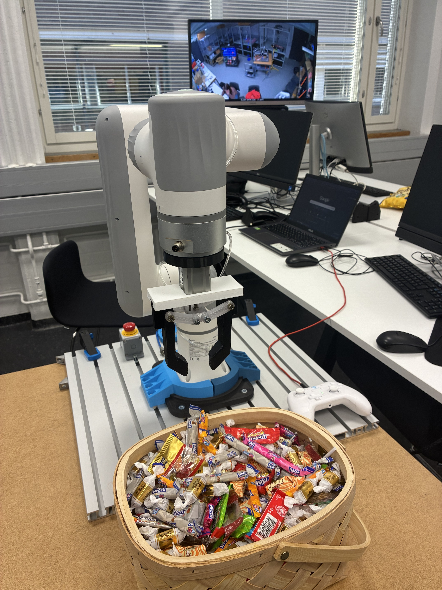
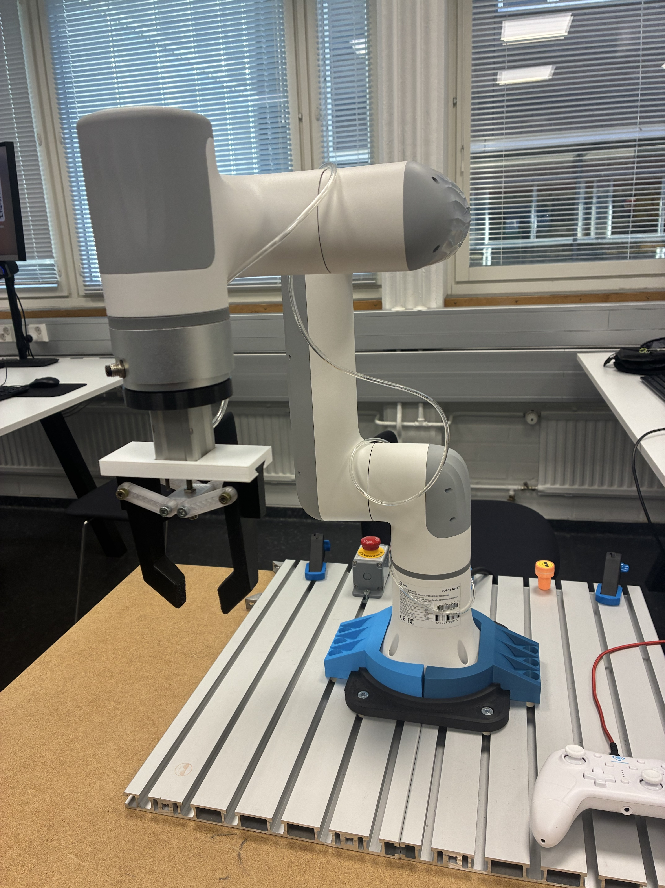
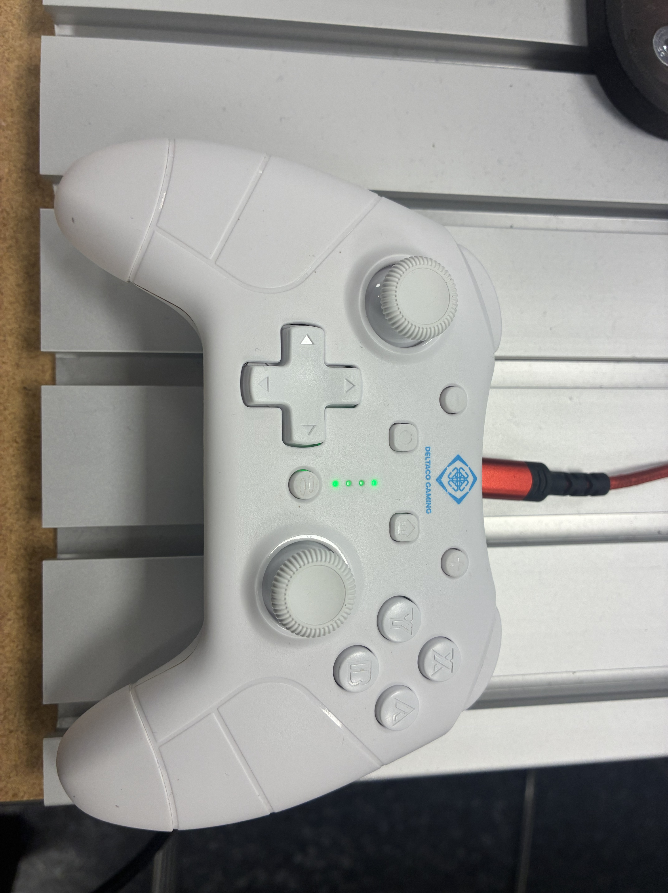
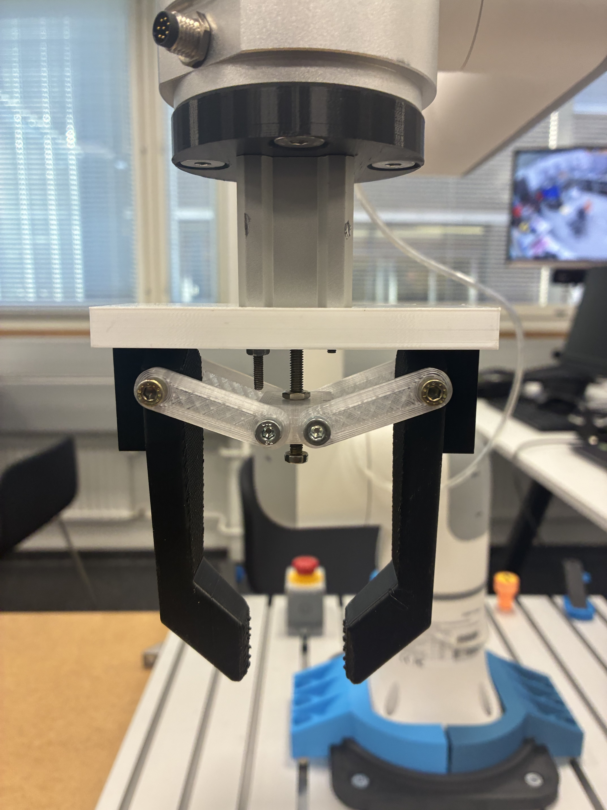
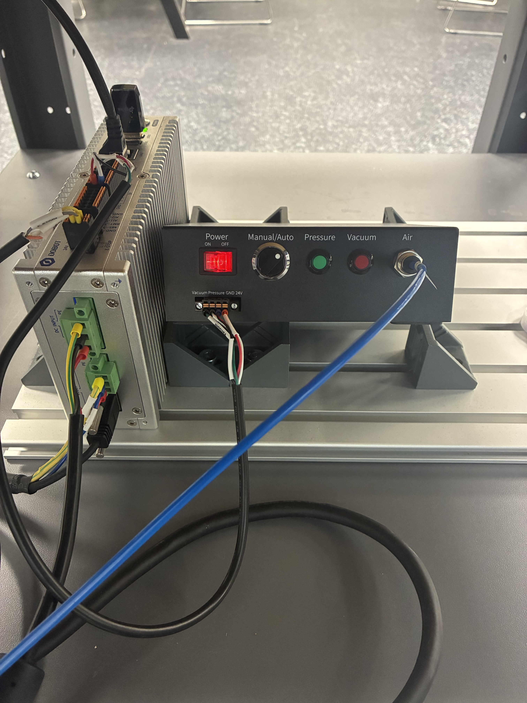

# Dobot XYZ Controller -- DELTACO Switch Pro Controller

## 1. Project overview

This project provides manual Cartesian jogging and tool rotation for a
Dobot robot using a Nintendo Switch Pro Controller. The controller is
read through `pygame`, while robot commands and feedback are handled
through `dobot_sdk`.

The program is designed around hold-to-move interaction:

-   Push and hold a stick to command movement along one robot axis.
-   Release the stick to stop the robot.
-   Movement is bounded by configured Cartesian and joint-rotation
    limits.
-   Before a Cartesian move, the program samples the straight-line path
    with inverse kinematics (`InverseKin`).
-   If a sampled point is unreachable, or the joint solution changes too
    much between samples, the requested movement is shortened to the
    last accepted sample.
-   The program monitors whether movement starts and checks the robot
    mode and alarms if it does not.

> **Important:** This is a project README based on the supplied source
> code. The source contains configuration and output-state
> inconsistencies listed in [Known issues to
> verify](#14-known-issues-to-verify). Resolve and test those items
> before relying on the controller.

## Real-world project photos

### Robot workstation and test setup

The photograph below shows the physical robot workstation, including the robot arm,
work surface, controller equipment and sample items used for the project.



## 2. Main features

-   Nintendo Switch Pro Controller input through `pygame`.
-   Cartesian jogging along X, Y and Z.
-   Tool rotation using joint 6.
-   Hold-to-move operation with stop-on-release behaviour.
-   Configurable XYZ and joint-6 limits.
-   Inverse-kinematics sampling along the requested Cartesian path.
-   Joint-angle jump check to reject potentially discontinuous IK
    solutions.
-   Watchdog for detecting a move that does not start.
-   Robot mode and alarm reporting.
-   Safe-pose and drop-pose button commands.
-   Two digital outputs controlled by one button.
-   Controller reconnect attempts after a disconnect.
-   Robot stop and disable commands during normal program shutdown.

## 3. System requirements

### Hardware

-   Compatible Dobot robot and controller.


-   Windows PC or another computer supported by the installed Dobot SDK
    and `pygame`.
-   Nintendo Switch Pro Controller.

-   Network connection between the PC and robot controller.
-   Suitable, correctly configured robot safety equipment and a clear
    working area.
- Vacume Gripper (Custom made)

- Vacume and Pressure Unit (Vacume controller)


### Software

-   Python.
-   `dobot_sdk` package and its supported dependencies.
-   `pygame`.

The supplied source imports:

``` python
import pygame
from dobot_sdk import DobotRobot, CoordinateType
```

Install `pygame` with:

``` bash
python -m pip install pygame
```

Install and configure `dobot_sdk` according to the SDK package and
robot-controller documentation used by the project. The supplied source
does not specify a package version or installation command for
`dobot_sdk`.

## 4. Network configuration

The robot address is configured near the top of the Python file:

``` python
ROBOT_IP = "192.168.5.1"
```

Change this value if the robot controller uses a different address.

Before running the program, verify that:

1.  The PC and robot controller are connected to the appropriate
    network.
2.  The PC can reach the configured robot IP address.
3.  The Dobot SDK can establish a connection to the controller.
4.  No other application is controlling the robot in a way that prevents
    this program from obtaining control.

The program requests control through:

``` python
control.RequestControl()
```

## 5. Configuration reference

The main settings are defined in the configuration section of the Python
file.

### 5.1 Robot and payload

  --------------------------------------------------------------------------
  Setting                               Supplied value Description
  --------------------- ------------------------------ ---------------------
  `ROBOT_IP`                             `192.168.5.1` Robot controller IP
                                                       address

  `PAYLOAD_KG`                                   `1.0` Payload value passed
                                                       to `EnableRobot`

  `SPEED_PERCENT`                                 `40` Robot speed factor
                                                       configured by the
                                                       program

  `SAFE_POSE_JOINT`       `[-90, -00, -90, 0, 90, 45]` Joint target used by
                                                       the safe-pose button

  `DROP_POSE_JOINT`        `[-180, 00, -90, 0, 90, 0]` Joint target used by
                                                       the drop-pose button

  `SAFE_POSE_WAIT`                         `2` seconds Fixed wait after the
                                                       initial safe-pose
                                                       command
  --------------------------------------------------------------------------

The pose arrays contain six joint values. Confirm that these targets are
valid for the specific robot, tool, installation and workcell before
use.

### 5.2 Cartesian limits

The supplied limits are:

  Axis     Minimum   Maximum Unit
  ------ --------- --------- ------
  X           -500      -200 mm
  Y           -300       150 mm
  Z            220       600 mm

They are configured as:

``` python
XYZ_LIMITS = {
    "y": (-300.0, 150.0),
    "x": (-500.0, -200.0),
    "z": (220.0, 600.0),
}
```

The program selects the minimum or maximum value according to the
requested direction. These are application limits, not a substitute for
the robot's configured safety limits or a validated workcell envelope.

Other related settings:

  ----------------------------------------------------------------------------
  Setting                                 Supplied value Description
  ------------------------- ---------------------------- ---------------------
  `LIMIT_TOLERANCE_MM`                             `0.5` Tolerance used when
                                                         checking whether an
                                                         axis is at a limit

  `REQUIRE_INSIDE_LIMITS`                         `True` Refuses jogging if
                                                         the current XYZ
                                                         position is outside
                                                         the configured box
  ----------------------------------------------------------------------------

When `REQUIRE_INSIDE_LIMITS` is enabled, the code checks the current
pose against all three configured ranges before starting a Cartesian
jog.

### 5.3 Tool rotation limit

The R command changes joint 6:

``` python
R_LIMITS = (-170.0, 170.0)
R_TOLERANCE_DEG = 0.5
```

The range is in degrees. Confirm the permissible range for the robot,
tool and cable arrangement before changing it.

### 5.4 Path reachability settings

  ---------------------------------------------------------------------------
  Setting                                Supplied value Description
  ------------------------ ---------------------------- ---------------------
  `REACH_SAMPLE_STEP_MM`                         `20.0` Distance between
                                                        Cartesian path
                                                        samples

  `REACH_MARGIN_MM`                               `5.0` Distance backed off
                                                        from the first
                                                        rejected sample

  `JOINT_JUMP_LIMIT_DEG`                         `45.0` Maximum permitted
                                                        change between
                                                        consecutive sampled
                                                        joint solutions
  ---------------------------------------------------------------------------

A smaller sample step checks the path more densely but requires more
inverse-kinematics calls. Sampling is an approximation: it does not
prove that every point between samples is safe or reachable.

### 5.5 Controller sensitivity and timing

  -------------------------------------------------------------------------
  Setting                              Supplied value Description
  ---------------------- ---------------------------- ---------------------
  `STICK_PUSH`                                  `0.5` Stick magnitude
                                                      required to start a
                                                      command

  `STICK_RELEASE`                               `0.3` Threshold below which
                                                      the active command is
                                                      released

  `POLL_INTERVAL`                            `0.03` s Main controller-loop
                                                      delay

  `RECONNECT_DELAY`                           `1.0` s Delay between
                                                      controller reconnect
                                                      attempts

  `MOVE_CHECK_TIMEOUT`                        `1.5` s Time before the
                                                      watchdog checks a
                                                      move that has not
                                                      visibly started

  `MOVE_THRESHOLD_MM`                        `0.2` mm Position change
                                                      treated as movement

  `MOVE_THRESHOLD_DEG`                  `0.2` degrees Rotation change
                                                      treated as movement
  -------------------------------------------------------------------------

The difference between `STICK_PUSH` and `STICK_RELEASE` provides
hysteresis. This helps prevent repeated start/stop changes when the
stick is near the activation threshold.

### 5.6 Robot mode values

The source defines the following values:

  Constant           Value Meaning in this program
  ---------------- ------- -------------------------
  `MODE_ENABLED`       `5` Enabled and idle
  `MODE_RUNNING`       `7` Executing a motion
  `MODE_ERROR`         `9` Alarm active
  `MODE_PAUSED`       `10` Paused

The source comment says these values should be verified against the
robot's TCP/IP protocol documentation and controller version.

## 6. Controller mapping

The supplied mapping is:

  Controller input         Pygame input      Robot command
  ------------------------ ----------------- ------------------------
  Left stick up/down       Axis 1, sign -1   X+ / X-
  Left stick right/left    Axis 0, sign +1   Y+ / Y-
  Right stick up/down      Axis 3, sign -1   Z+ / Z-
  Right stick right/left   Axis 2, sign +1   R+ / R- (joint 6)
  A                        Button 0          Move to safe pose
  B                        Button 1          Move to drop pose
  X                        Button 2          Stop
  Y                        Button 3          Switch digital outputs
  Plus                     Button 6          Quit

Controller axis and button numbering can vary by operating system,
connection method and controller driver. The mapping must be checked on
the actual computer.

### Test controller input

Run:

``` bash
python your_script.py --test
```

The test mode prints the raw axis values and the indices of pressed
buttons. Use these readings to update `STICK_AXES` and the `BTN_*`
constants if necessary.

## 7. User operation

### 7.1 Startup

When the program starts, it:

1.  Initializes `pygame` and its joystick subsystem.
2.  Connects to the robot using `DobotRobot(ROBOT_IP)`.
3.  Requests robot control.
4.  Clears existing errors.
5.  Enables the robot with the configured payload.
6.  Sets the speed factor.
7.  Starts the feedback monitor and waits one second.
8.  Commands the configured safe joint pose.
9.  Waits `SAFE_POSE_WAIT` seconds.
10. Reads and prints the starting tool pose.
11. Prints warnings if the starting coordinates are outside the
    configured XYZ ranges.
12. Starts the controller loop.

The supplied startup code uses a fixed sleep after commanding the safe
pose. It does not explicitly confirm that the pose move has completed
before continuing.

### 7.2 Manual jogging

Push and hold a stick beyond `STICK_PUSH` to request movement. The
program selects one active axis at a time. If an axis is already active,
it remains selected until its magnitude falls below `STICK_RELEASE`,
unless another stronger input is selected after release.

When the desired command changes, the program stops the previous jog
before starting the next one.

Releasing the active stick causes the main loop to call the robot stop
command.

### 7.3 Pose buttons

-   **A:** requests the configured safe joint pose.
-   **B:** requests the configured drop joint pose.
-   **X:** stops motion.
-   **Plus:** exits the controller loop; shutdown code then stops and
    disables the robot.

The pose buttons use joint movement (`MovJ`) with
`CoordinateType.JOINT`.

### 7.4 Digital outputs

The output pair is configured as:

``` python
DO_PAIR = (1, 2)
DO_APPLY_AT_START = True
DO_SWITCH_GAP = 0.05
DO_METHOD = "DO"
```

`DO_PAIR` identifies the two digital output indices. The output function
first sends OFF commands to both outputs, waits for the configured gap,
and then applies the requested state.

The supplied implementation's actual state behaviour is:

    State value D1    D2
  ------------- ----- -----
            `0` OFF   OFF
            `1` ON    OFF
            `2` OFF   ON

The Y-button handler cycles through these three states using modulo 3.
The comments in the supplied code do not consistently describe this
actual behaviour; see [Known issues to
verify](#14-known-issues-to-verify).

The code uses `robot.io.DO` by default. The source comments that `DO`
may be queued and may wait for a running move to finish. It mentions
`DOInstant` as an alternative if the installed SDK supports it. Verify
the API and timing behaviour for the actual controller and SDK before
changing this setting.

## 8. Cartesian path reachability check

Before a Cartesian jog, `start_jog()`:

1.  Reads the current tool pose.
2.  Checks whether the current XYZ position is inside `XYZ_LIMITS` when
    `REQUIRE_INSIDE_LIMITS` is enabled.
3.  Determines the requested minimum or maximum coordinate for the
    selected axis.
4.  Checks for an active robot alarm.
5.  Calls `farthest_reachable()` to sample the straight-line path.
6.  Uses inverse kinematics at each sample.
7.  Supplies the previous joint solution as the near solution for the
    next sample when available.
8.  Rejects a sample if inverse kinematics fails.
9.  Rejects a sample if the maximum joint-angle change exceeds
    `JOINT_JUMP_LIMIT_DEG`.
10. If a sample is rejected, backs off from the last accepted point by
    `REACH_MARGIN_MM`.
11. Sends a Cartesian linear movement using
    `robot.motion.MovL(target, CARTESIAN)`.

This check is intended to avoid sending a complete requested path when
the sampled path cannot be solved consistently. It is not a safety-rated
collision detector and does not replace workcell risk assessment, robot
safety functions or physical safeguarding.

## 9. Movement monitoring and alarms

The movement watchdog records the starting pose and waits up to
`MOVE_CHECK_TIMEOUT` for a measurable change.

The code compares the latest pose with the starting pose using:

-   `MOVE_THRESHOLD_MM` for X, Y and Z.
-   `MOVE_THRESHOLD_DEG` for RX, RY and RZ.

If movement is not detected before the deadline, `check_watch()` reads
the robot mode and active alarms. Its supplied behaviour is:

-   If the robot is running and there is no alarm, it continues waiting
    by ending the current watch.
-   If the robot is enabled and idle, it reports that the robot is idle
    or may already be at the target.
-   If the robot is paused and has not yet been resumed by the watchdog,
    it sends `Continue()` and extends the deadline.
-   Otherwise, it reports the state and may call `recover()` and retry
    the command once.

The supplied `send_and_watch()` function also attempts recovery and a
retry when the initial motion command response is rejected.

### Alarm handling

`active_alarms()` parses non-zero alarm IDs from `GetErrorID()`.
`ensure_no_alarm()` attempts `ClearError()` when it detects an active
alarm, then checks whether the alarm remains.

For troubleshooting, preserve the complete raw `GetErrorID()` response
before clearing an alarm. An alarm number alone may not provide enough
information to determine its cause. Do not repeatedly clear or retry an
alarm without first identifying and addressing its cause.

## 10. Program structure

  -----------------------------------------------------------------------
  Function                            Responsibility
  ----------------------------------- -----------------------------------
  `setup_robot()`                     Requests control, clears errors,
                                      enables the robot, sets speed and
                                      starts feedback monitoring

  `get_pose()`                        Reads the current Cartesian tool
                                      pose

  `command_ok()`                      Checks whether a string response
                                      starts with error ID `0`

  `read_mode()`                       Parses the robot mode

  `active_alarms()`                   Extracts non-zero alarm IDs

  `ensure_no_alarm()`                 Attempts to clear active alarms

  `report_state()`                    Prints robot mode and error
                                      response

  `recover()`                         Sends Stop, ClearError and Continue

  `moved_since()`                     Compares current and previous pose

  `parse_floats()`                    Parses numeric values from a Dobot
                                      response

  `get_joints()`                      Reads the current joint angles

  `ik_check()`                        Runs inverse kinematics for a
                                      target pose

  `farthest_reachable()`              Samples a Cartesian path and finds
                                      the last accepted point

  `send_and_watch()`                  Sends a motion command and creates
                                      a watchdog record

  `check_watch()`                     Monitors whether movement starts
                                      and checks robot state

  `start_jog()`                       Calculates and starts a bounded
                                      Cartesian jog

  `start_rotate()`                    Commands joint-6 rotation within
                                      configured limits

  `start_motion()`                    Selects Cartesian jogging or
                                      joint-6 rotation

  `go_to_pose()`                      Commands a named joint pose

  `stop_motion()`                     Stops the robot and prints the
                                      resulting pose and alarms

  `set_output()`                      Sets one digital output

  `switch_outputs()`                  Applies one of the configured
                                      two-output states

  `connect_controller()`              Connects to the first detected
                                      joystick

  `stick_command()`                   Converts stick positions into one
                                      requested axis/direction

  `control_loop()`                    Runs the controller event and
                                      movement-monitoring loop

  `test_controller()`                 Displays raw controller axes and
                                      pressed buttons

  `main()`                            Initializes the application and
                                      performs startup/shutdown
  -----------------------------------------------------------------------

## 11. Shutdown behaviour

The normal shutdown path:

1.  Calls the robot stop command.
2.  Stops the feedback monitor.
3.  Disables the robot.
4.  Prints `Robot disabled.`
5.  Quits `pygame`.

The controller disconnect and controller read-error paths also call the
program's stop handler.

## 12. Troubleshooting

### Controller is not detected

1.  Run the program with `--test`.
2.  Confirm that the operating system detects the controller.
3.  Check that `pygame.joystick.get_count()` is greater than zero.
4.  Check the reported axis and button counts.
5.  Update the mapping if the indices differ.

### Movement does not start

1.  Check the robot's displayed state and alarms.
2.  Capture the full response from `RobotMode()` and `GetErrorID()`.
3.  Check the response returned by `MovL()` or `MovJ()`.
4.  Confirm that the robot is enabled and that the program has control.
5.  Confirm that the target and sampled path are reachable.
6.  Check that the starting pose is inside the configured XYZ ranges.

### Program reports that a path is not fully reachable

The path checker has rejected one of its inverse-kinematics samples or
detected a joint-angle jump larger than `JOINT_JUMP_LIMIT_DEG`.

Check the robot pose, tool configuration, joint angles, coordinate
convention and target path. Do not simply increase the configured
workspace limits or joint-jump threshold to suppress the message.

### Robot stops and reports an alarm

Record the raw `GetErrorID()` response and `RobotMode()` before clearing
the alarm. Consult the robot/controller documentation for the reported
alarm. Check the physical workcell and robot state before attempting
another movement.

### Controller disconnect message

The message `Controller disconnected - stopping the robot.` is generated
by the `pygame.JOYDEVICEREMOVED` event. It indicates that the game
controller was removed from pygame's device list; it does not by itself
prove that the robot's Ethernet connection was lost.

## 13. Safety and commissioning notes

-   This is a manual control application, not a safety-rated robot
    controller.
-   Use the robot's approved safety functions, emergency stop, guarding
    and workcell procedures.
-   Keep people outside the robot's hazardous operating area during
    testing.
-   Confirm the tool, payload, joint targets, coordinate frame and work
    envelope before enabling movement.
-   Begin commissioning at a suitably low speed and use the robot
    manufacturer's approved procedure.
-   Verify the stop behaviour, controller-loss behaviour and shutdown
    behaviour under controlled conditions.
-   Verify digital-output wiring and the connected equipment's safe
    state. Software sequencing alone does not guarantee electrical or
    functional safety.
-   Do not bypass alarms, interlocks, protective stops or manufacturer
    safety limits.
-   The inverse-kinematics sampling check does not detect every
    collision or guarantee a safe path.

## 14. Known issues to verify

The following points are visible in the supplied source and should be
checked before treating the documentation or program as final.

### 14.1 X/Y pose index mapping

`get_pose()` returns:

``` python
[x, y, z, rx, ry, rz]
```

However, the supplied configuration says:

``` python
AXIS_INDEX = {"x": 1, "y": 0, "z": 2}
```

This maps the X command to pose element 1 (Y) and the Y command to pose
element 0 (X). If the SDK's `tool_vector_actual` fields are the
conventional X/Y/Z fields used by `get_pose()`, the mapping should
instead be:

``` python
AXIS_INDEX = {"x": 0, "y": 1, "z": 2}
```

Confirm the SDK pose convention before changing it. The axis index is
used for both limit checks and target construction, so an incorrect
mapping affects more than the displayed direction.

### 14.2 Digital-output state comments and startup value

The supplied `switch_outputs()` implementation actually behaves as
follows:

-   `new == 0`: both outputs remain OFF.
-   `new == 1`: D1 is turned ON.
-   `new == 2`: D2 is turned ON.

The code sets `DO_PAIR_START = 0`, so with `DO_APPLY_AT_START = True` it
starts with both outputs OFF. This differs from the nearby comment
saying state 0 selects the first output.

The Y-button code uses `(current_state + 1) % 3`, which is consistent
with three states, not four. Update the comments and `DO_PAIR_START`
according to the intended initial state.

### 14.3 Output command result checking

In the supplied `switch_outputs()` function, the return value from some
`set_output()` calls is not checked. In particular, the D1 OFF command
in state 2 is not checked. Review all output command results and ensure
the software's recorded state reflects the commands that actually
succeeded.

### 14.4 Motion retry behaviour

The supplied code may retry a rejected or stalled motion after `Stop()`,
`ClearError()` and `Continue()`. During fault diagnosis, it is
preferable to capture the raw alarm and command response first and avoid
automatic retries until the cause is understood.

### 14.5 Startup pose completion

The initial safe-pose movement is followed by a fixed two-second sleep.
The source does not confirm that the robot has completed the move before
reading the starting pose and starting the controller loop. A completion
check would make startup state verification more reliable.

### 14.6 Controller disconnect versus robot connection

The controller disconnect event is a pygame joystick event. It should
not be described as a robot network disconnection. Robot communication
errors should be logged and handled separately.

## 15. Suggested future improvements

-   Add an explicit motion-completion check for startup and pose
    movements.
-   Separate controller connection monitoring from robot
    network/feedback monitoring.
-   Add structured logging with timestamps, raw command responses, robot
    mode, alarms, pose and joint angles.
-   Validate the Cartesian axis mapping and coordinate frame against the
    robot SDK.
-   Make output-state transitions fail-safe and verify every output
    command response.
-   Add a configuration file so robot IP, limits and controller mapping
    can be changed without editing the source.
-   Add automated tests for parsing robot responses, axis mapping and
    output-state transitions.

## 16. Quick reference

### Run the controller

``` bash
python your_script.py
```

### Test the game controller

``` bash
python your_script.py --test
```

### Install pygame

``` bash
python -m pip install pygame
```

### Main controls

  Input                    Action
  ------------------------ ----------------------------
  Left stick up/down       X+ / X-
  Left stick right/left    Y+ / Y-
  Right stick up/down      Z+ / Z-
  Right stick right/left   R+ / R-
  A                        Safe pose
  B                        Drop pose
  X                        Stop
  Y                        Cycle digital-output state
  Plus                     Quit

------------------------------------------------------------------------

**Document scope:** This documentation describes the supplied Python
source and its stated behaviour. Robot-specific limits, SDK
compatibility, coordinate conventions, controller mappings and safety
requirements must be verified on the actual hardware and controller
version.
